<div align="center">


# TraininGenie

### Transcend Beyond Growth.

**Corporate training for your teams, designed around your requirement.**<br/>
Technology · Leadership and soft skills · ITIL, PRINCE2 and Agile · ISO, Standards and GRC

[](https://nextjs.org)
[](https://react.dev)
[](https://www.typescriptlang.org)
[](https://tailwindcss.com)
[](https://react.dev/learn/react-compiler)
[](#performance-and-security)

[**trainingenie.com**](https://www.trainingenie.com) &nbsp;·&nbsp; [Screenshots](#screenshots) &nbsp;·&nbsp; [Getting started](#getting-started) &nbsp;·&nbsp; [Editing content](#editing-content) &nbsp;·&nbsp; [Deploying](#deploying)

<br/>

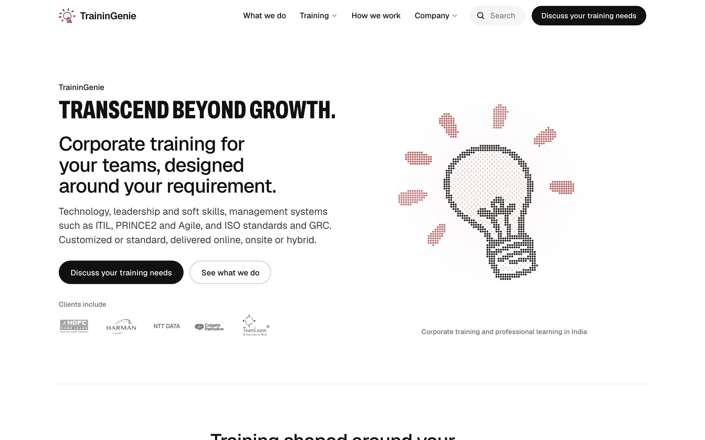

</div>

<br/>

## Contents

- [What this is](#what-this-is)
- [Highlights](#highlights)
- [Screenshots](#screenshots)
- [Design language](#design-language)
- [Site map](#site-map)
- [The enquiry flow](#the-enquiry-flow)
- [Search engines and AI answers](#search-engines-and-ai-answers)
- [Accessibility](#accessibility)
- [Performance and security](#performance-and-security)
- [Tech stack](#tech-stack)
- [Project structure](#project-structure)
- [Getting started](#getting-started)
- [Editing content](#editing-content)
- [Quality checks](#quality-checks)
- [Deploying](#deploying)
- [Licence](#licence)

<br/>

## What this is

The website of **TraininGenie** (Trainingenie (OPC) Private Limited), a corporate learning and development partner based in Bengaluru and Kolkata. The company delivers need-based training, certification preparation, technology learning, leadership development and management-systems training to organizations across India: online, onsite or hybrid.

The site has one job: help an L&D, HR or engineering lead **trust TraininGenie quickly and send an enquiry**. Every page is built around that: real client logos and the registered company record close to every call to action, programme pages that say exactly what is covered and who it is for, a short enquiry form that pre-fills the topic you came from, and one consistent experience on a 360px phone and a 1920px monitor.

<br/>

## Highlights

| | |
|---|---|
| **A signature hero** | The brand's lightbulb redrawn as a field of dots that assembles on load and leans toward the pointer, beside the condensed uppercase slogan. Canvas-rendered, no images, and it respects *reduced motion*. |
| **Trust where decisions happen** | 12 client logos (HDFC, Harman, NTT DATA, Colgate-Palmolive, TeamLease, Subex, metricstream and more), the registered company record with a copyable CIN, and the founder profile, surfaced beside every primary action rather than buried on one page. |
| **Four training areas, seven focused programmes** | ITIL 4 Foundation, PRINCE2, Scrum and Agile, ISO 27001, ISO 9001, Design Thinking and ReactJS, each with what it covers, key concepts, who should attend, how it is customized and related programmes. |
| **Enquiry in under a minute** | One form, inline validation, a topic pre-filled from whichever page you came from, a draft that survives a refresh, and a thank-you page that confirms what was sent. |
| **Site-wide search** | <kbd>⌘</kbd>/<kbd>Ctrl</kbd> + <kbd>K</kbd> opens instant search across areas, programmes, 45 topics, FAQs and pages, with synonyms ("certificate", "public speaking", "BFSI", city names) that map only to pages that genuinely cover them. |
| **Phone-first, not phone-later** | The same components, rhythm and type scale at every width: a sticky action bar, a full-screen menu with focus trapping, folded details where a phone needs less scrolling, and 44px tap targets throughout. |
| **Built to be found** | Per-page metadata and canonicals, rich JSON-LD (Organization, Course, Service, FAQPage, BreadcrumbList and more), generated share cards for every programme and area, a sitemap, `llms.txt` for AI assistants, and IndexNow pings. |
| **Fast and locked down** | Every route is prerendered static HTML, fonts are self-hosted, the React Compiler is on, and production ships a strict Content Security Policy plus modern security headers. |

<br/>

## Screenshots

### Desktop

<table>
  <tr>
    <td width="50%">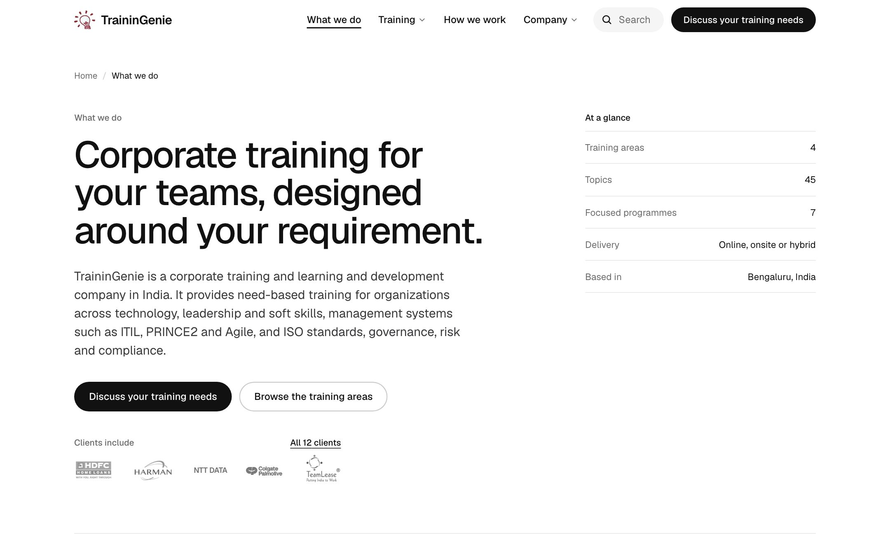<br/><sub><b>What we do</b>: the offer in one page, with who each kind of training is for.</sub></td>
    <td width="50%">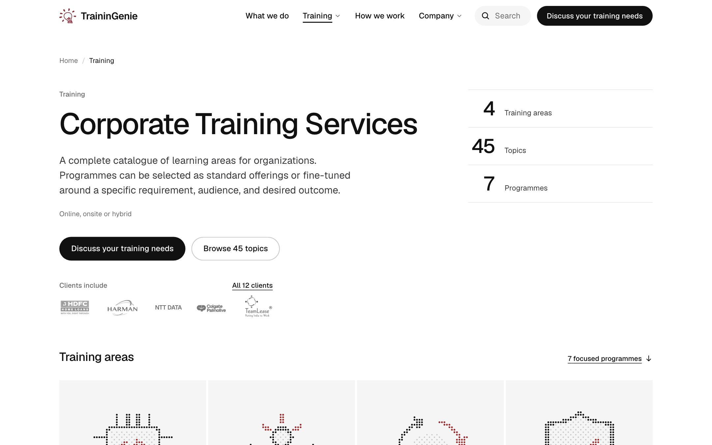<br/><sub><b>Training catalogue</b>: all four areas, the focused programmes and every topic.</sub></td>
  </tr>
  <tr>
    <td width="50%">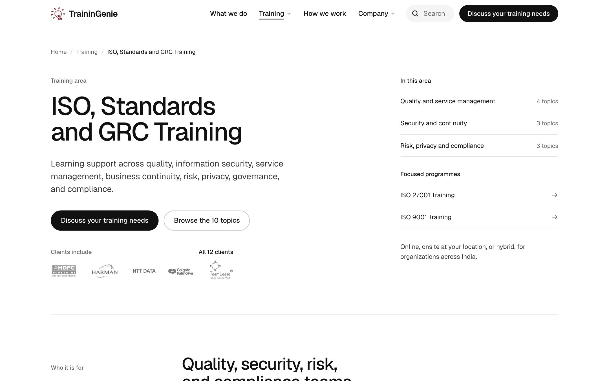<br/><sub><b>Training area</b>: topics grouped by theme, focused programmes and client proof up front.</sub></td>
    <td width="50%">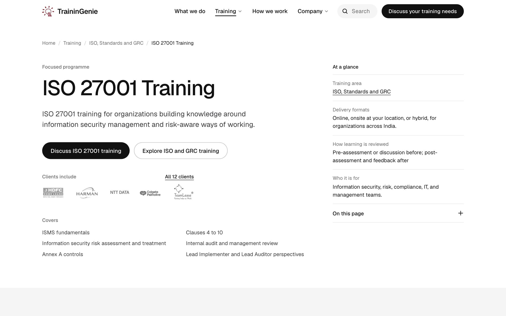<br/><sub><b>Programme</b>: what it covers, delivery formats, how learning is reviewed and who it is for, at a glance.</sub></td>
  </tr>
  <tr>
    <td width="50%">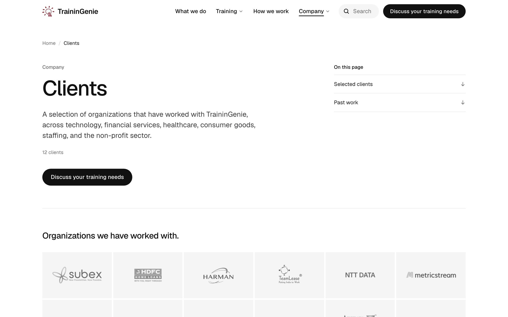<br/><sub><b>Clients</b>: the full logo wall and past work.</sub></td>
    <td width="50%">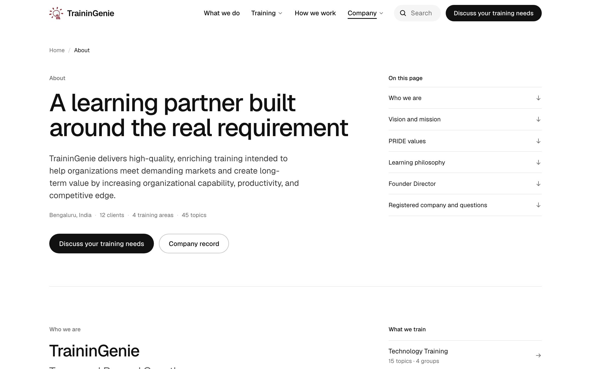<br/><sub><b>About</b>: vision, mission, values and the registered company record.</sub></td>
  </tr>
  <tr>
    <td width="50%">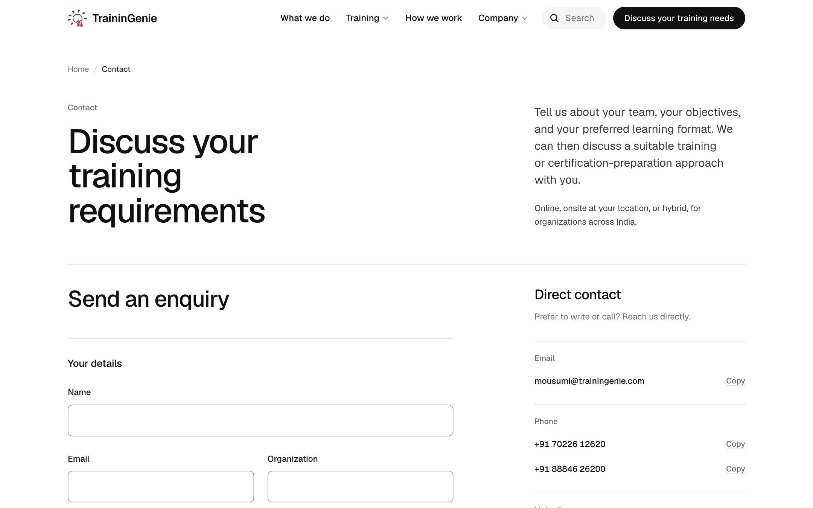<br/><sub><b>Contact</b>: the enquiry form beside direct email and phone, each one tap to copy.</sub></td>
    <td width="50%">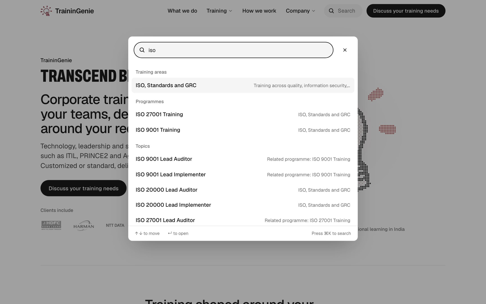<br/><sub><b>Search</b>: <kbd>⌘K</kbd> from anywhere; areas, programmes and topics as you type.</sub></td>
  </tr>
</table>

### Phone

<table>
  <tr>
    <td width="20%">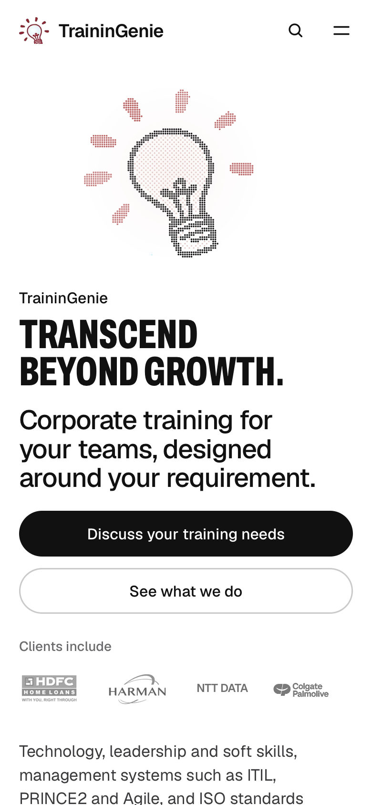<br/><sub><b>Landing</b></sub></td>
    <td width="20%">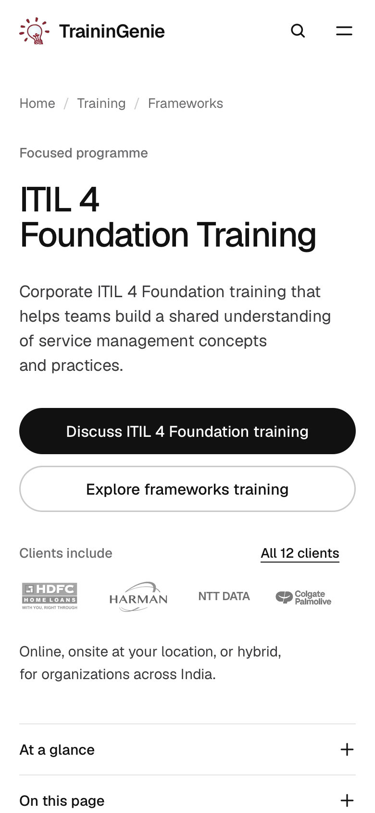<br/><sub><b>Programme</b></sub></td>
    <td width="20%">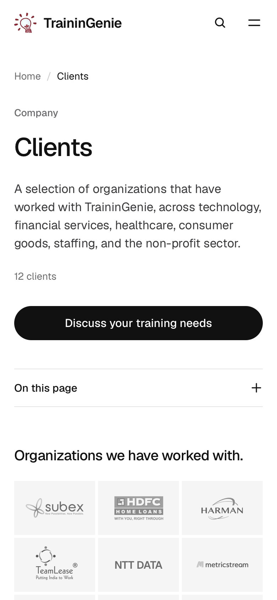<br/><sub><b>Clients</b></sub></td>
    <td width="20%">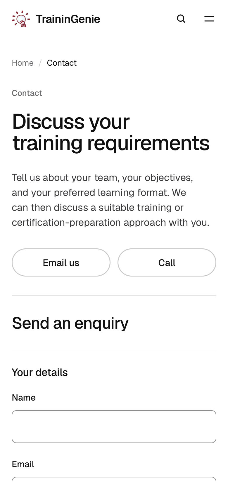<br/><sub><b>Contact</b></sub></td>
    <td width="20%">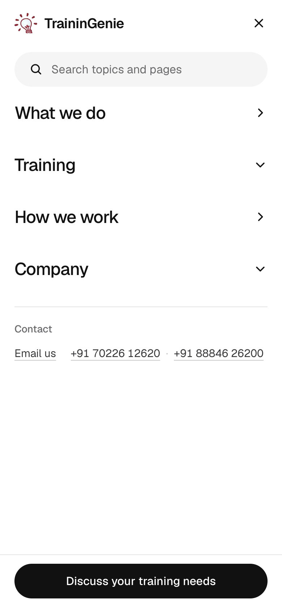<br/><sub><b>Menu</b></sub></td>
  </tr>
</table>

<details>
<summary><b>The whole landing page, top to bottom</b></summary>
<br/>
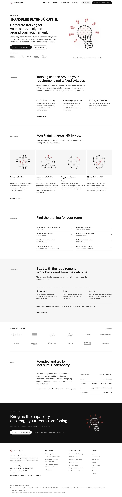
</details>

<br/>

## Design language

Quiet, confident and editorial: the restraint of a sportswear flagship site applied to B2B training. The brand is carried by type, space and one mark, not decoration.

- **Black, white and greys, with one red.** Bulb red `#9e2a2b` is reserved for the bulb, the emblems and keyboard focus, so it always means *TraininGenie*. No gradients, drop shadows or stock photography.
- **Two typefaces.** [Geist](https://vercel.com/font) for everything, self-hosted through `next/font`; condensed **Archivo** for the landing slogan only, loaded on that page alone.
- **A token system, not one-off values.** Colours, radii and a fluid type scale (`type-display`, `type-h2`, `type-body` and the rest) live in [`src/app/globals.css`](src/app/globals.css) as Tailwind v4 `@theme` tokens and `@utility` classes. Every text colour clears WCAG AA, and body copy sits at 11.6:1 on white.
- **Dot language.** The hero bulb, the 404 numeral and the programme emblems are drawn from the same sampled dot grid, so illustrations stay on brand without a single bitmap.
- **One layout, every width.** A 12-column grid on desktop that collapses to a single measured column on phones, with the same components, order and hierarchy, just re-flowed.

| Token | Value | Used for |
|---|---|---|
| `--foreground` | `#111111` | Headings, key text, the primary pill |
| `--copy` | `#39393b` | Any sentence that can wrap |
| `--muted-foreground` | `#6b6b6d` | One-line metadata and labels |
| `--field` | `#f5f5f5` | Search pill, quiet fields, logo tiles |
| `--border` | `#e5e5e5` | Hairlines |
| `--accent` | `#9e2a2b` | The bulb, emblems, focus rings |

<br/>

## Site map

| Route | What it is |
|---|---|
| `/` | Landing: slogan and bulb, clients, training areas, how an engagement works, the company record and the founder |
| `/what-we-do` | The offer on one page, and who each kind of training is for |
| `/corporate-training-services` | The full catalogue: four areas, focused programmes and every topic |
| `/technology-training` · `/leadership-soft-skills-training` · `/itil-prince2-agile-training` · `/iso-standards-training` | The four training areas |
| `/itil-4-foundation-training` · `/prince2-training` · `/scrum-agile-training` · `/iso-27001-training` · `/iso-9001-training` · `/design-thinking-workshop` · `/reactjs-training` | Seven focused programme pages, all generated from [`src/data/course-details.ts`](src/data/course-details.ts) by one dynamic route |
| `/training-methodology` | How an engagement runs, from requirement to review |
| `/about-us` · `/our-team` | The company, its registered record and the founder director |
| `/clients-and-testimonials` · `/past-trainings` | Clients and delivered work |
| `/faqs` | Searchable answers for buyers |
| `/contact-us` · `/thank-you` | Enquiry and confirmation |
| `/privacy-policy` · `/blog` | Policy and updates |

Legacy URLs (`/about`, `/services`, `/contact`, `/case-studies`) redirect permanently to their new homes, and any unknown path renders a branded 404 with useful next steps.

<br/>

## The enquiry flow

```text
Any "Discuss … training" button  →  /contact-us?topic=<programme>#enquiry  →  FormSubmit  →  /thank-you
```

- The form posts to [FormSubmit](https://formsubmit.co) at the address in `CONTACT_INFO.email`, so there is no backend to run.
- The topic follows `?topic=` (including a site search made from the contact page) but never overwrites what the visitor typed.
- Inline, accessible validation: errors are announced, `aria-invalid` is set, and focus moves to the first problem. A honeypot field keeps bots out.
- An unfinished enquiry is kept as a draft for the browser session, and the thank-you page confirms the email and topic it was sent with.

<br/>

## Search engines and AI answers

- **Metadata:** a unique title, description, canonical URL, Open Graph and Twitter card on every page, from one helper, `pageMetadata()` in [`src/lib/seo.tsx`](src/lib/seo.tsx).
- **Structured data:** Organization (with the legal entity, CIN and contact points), WebSite, Course, Service, OfferCatalog, FAQPage, ProfilePage, AboutPage and BreadcrumbList, always matching the visible text.
- **Share cards:** generated at build time with `next/og`, one for the site, one per training area and one per programme, using the same dot-drawn emblems.
- **Discovery:** `sitemap.xml`, `robots.txt`, a web app manifest, [`public/llms.txt`](public/llms.txt) for AI assistants, and `npm run indexnow` to notify Bing, Yandex and other IndexNow engines after a deploy.

<br/>

## Accessibility

- A skip link, landmarks, one `h1` per page and a logical heading outline.
- A visible focus ring everywhere (bulb red, 2px), with focus moved to the new page's heading after client-side navigation.
- The phone menu is a modal dialog that traps focus, closes on <kbd>Esc</kbd> and returns focus to its button.
- Native `<details>` disclosures, real form labels and hints wired with `aria-describedby`.
- `prefers-reduced-motion` stops the bulb assembly and smooth scrolling; the print stylesheet opens every disclosure and adds the page address.

<br/>

## Performance and security

- **Static by default:** every route, including the seven programme pages and their share cards, is prerendered at build time.
- **React Compiler** (`reactCompiler: true`) for automatic memoization, and fonts self-hosted with `display: swap`.
- **Production headers:** a strict Content Security Policy (`default-src 'self'`, form posts only to FormSubmit, no framing), `X-Content-Type-Options`, `Referrer-Policy`, a locked-down `Permissions-Policy` and `X-Frame-Options: DENY`.

<br/>

## Tech stack

| Layer | Choice |
|---|---|
| Framework | [Next.js 16](https://nextjs.org) App Router, static generation |
| UI | [React 19](https://react.dev) with the React Compiler |
| Language | TypeScript (strict) |
| Styling | [Tailwind CSS v4](https://tailwindcss.com) with CSS-first `@theme` tokens |
| Motion | Canvas for the bulb; CSS transitions elsewhere |
| Forms | Native form + [FormSubmit](https://formsubmit.co) |
| Images | `next/image`, `next/og` for share cards |
| Quality | ESLint 9, `tsc --noEmit` |

<br/>

## Project structure

```text
src/
├── app/                      Routes (App Router), metadata routes and global styles
│   ├── [slug]/               The seven programme pages + their share cards
│   ├── <area>/               Four training areas, each with its own share card
│   ├── globals.css           Design tokens, type scale and print rules
│   ├── icon.svg              The transparent bulb favicon
│   ├── layout.tsx            Root layout: header, footer, skip link, JSON-LD
│   ├── manifest.ts · robots.ts · sitemap.ts
│   └── opengraph-image.tsx   The site share card
├── components/
│   ├── brand/                The particle bulb, emblems and the slogan font
│   ├── tg/                   The design system: header, footer, hero, buttons, sections, lists, logo wall …
│   ├── kit/                  Behaviour: search (⌘K), accordion, disclosure, phone action bar, route focus
│   ├── company/              The company record, CIN copy and past-training groups
│   ├── catalogue/ · site/    Catalogue and training-area helpers
│   ├── utility/              Copy buttons, FAQ search, share actions, client-only rendering
│   └── contact-form.tsx      The enquiry form
├── data/                     All site content: company, courses, clients, FAQs, methodology, copy
└── lib/                      SEO helpers, the search index, share-card renderer, enquiry links
public/
├── client-logos/             The 12 client logos
├── llms.txt                  A plain-text brief for AI assistants
└── icon-512.png              App icon
docs/screenshots/             The images in this README
scripts/indexnow.mjs          Notify search engines after a deploy
```

<br/>

## Getting started

**Requirements:** Node.js 20.9 or newer, and npm.

```bash
git clone https://github.com/ayushman46/Trainingenie.git
cd Trainingenie
npm install
npm run dev
```

Open [http://localhost:3000](http://localhost:3000).

| Script | What it does |
|---|---|
| `npm run dev` | Development server with hot reload |
| `npm run build` | Production build (type-checks and prerenders every page) |
| `npm run start` | Serve the production build |
| `npm run lint` | ESLint |
| `npm run typecheck` | TypeScript, no emit |
| `npm run check` | Lint + typecheck |
| `npm run indexnow` | Ping IndexNow engines with every URL in the live sitemap (run after a deploy) |

> [!NOTE]
> The production Content Security Policy includes `upgrade-insecure-requests`. Safari therefore refuses to load assets from `next start` over plain `http://localhost`. Use `npm run dev` for local Safari testing; production on HTTPS is unaffected.

<br/>

## Editing content

Content lives in typed data files, not in components, so most updates are a one-line change:

| To change… | Edit |
|---|---|
| Email, phones, LinkedIn, company name, tagline | [`src/data/constants.ts`](src/data/constants.ts) |
| Legal entity, CIN, registered office | [`src/data/legal-entity.ts`](src/data/legal-entity.ts) |
| Programme pages (overview, concepts, audience, FAQs) | [`src/data/course-details.ts`](src/data/course-details.ts) |
| Client logos and names | [`src/data/clients.ts`](src/data/clients.ts) + `public/client-logos/` |
| FAQs | [`src/data/faqs.ts`](src/data/faqs.ts) |
| How an engagement works | [`src/data/methodology.ts`](src/data/methodology.ts) |
| Shared labels and calls to action | [`src/data/site-copy.ts`](src/data/site-copy.ts) |
| Search synonyms | [`src/lib/search-index.ts`](src/lib/search-index.ts) |

Structured data, share cards, the sitemap and search all read from the same files, so they stay in step automatically. Keep `public/llms.txt` in step by hand.

<br/>

## Quality checks

Before every release:

```bash
npm run check && npm run build
```

The redesign was also reviewed across all 25 routes at 360, 390, 1024, 1440 and 1920px in Chromium and WebKit: no horizontal overflow, no console errors, every internal link and `#fragment` resolving, FAQ structured data matching the visible answers, and the enquiry form validated end to end with submissions intercepted.

<br/>

## Deploying

The site is fully static and deploys to any Next.js host; [Vercel](https://vercel.com) needs no configuration.

**After the first deploy:**

1. **Activate the enquiry address.** Send one test enquiry from the live `/contact-us`. FormSubmit emails an activation link to the address in `CONTACT_INFO.email`, and enquiries are delivered only after it is clicked.
2. Run `npm run indexnow` to tell search engines about every page.
3. Check a programme link in a social preview tool (LinkedIn Post Inspector, for example) to confirm its share card.

<br/>

## Licence

Proprietary. © 2026 TraininGenie. All rights reserved. See [`LICENCE`](LICENCE).

<div align="center">
<br/>
<br/>
<sub><b>TraininGenie</b> · Bengaluru and Kolkata, India · <a href="https://www.trainingenie.com">trainingenie.com</a></sub>
</div>
